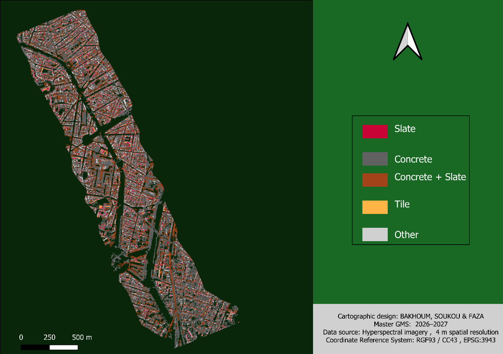
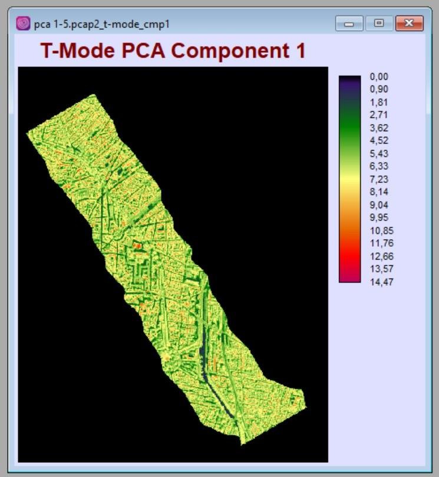
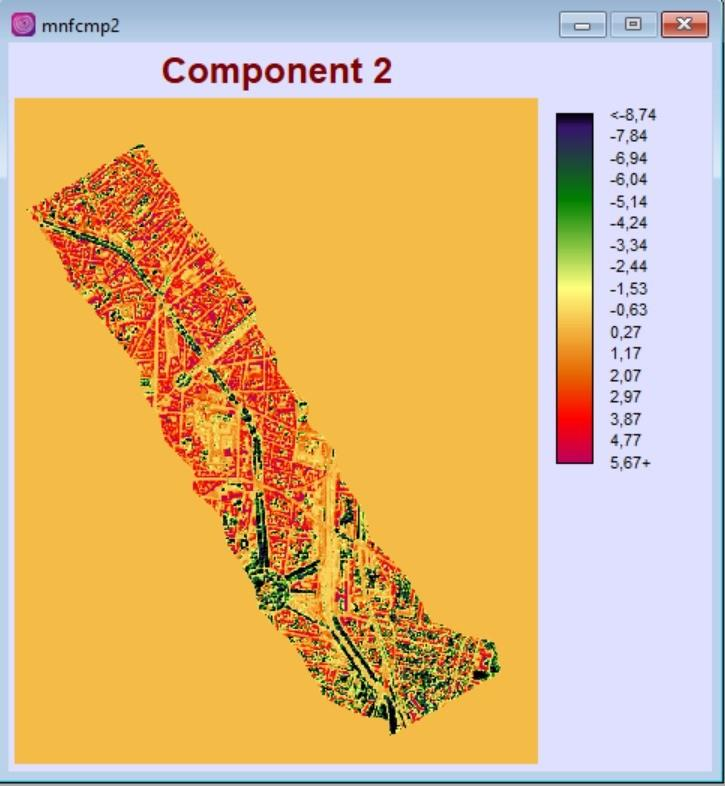
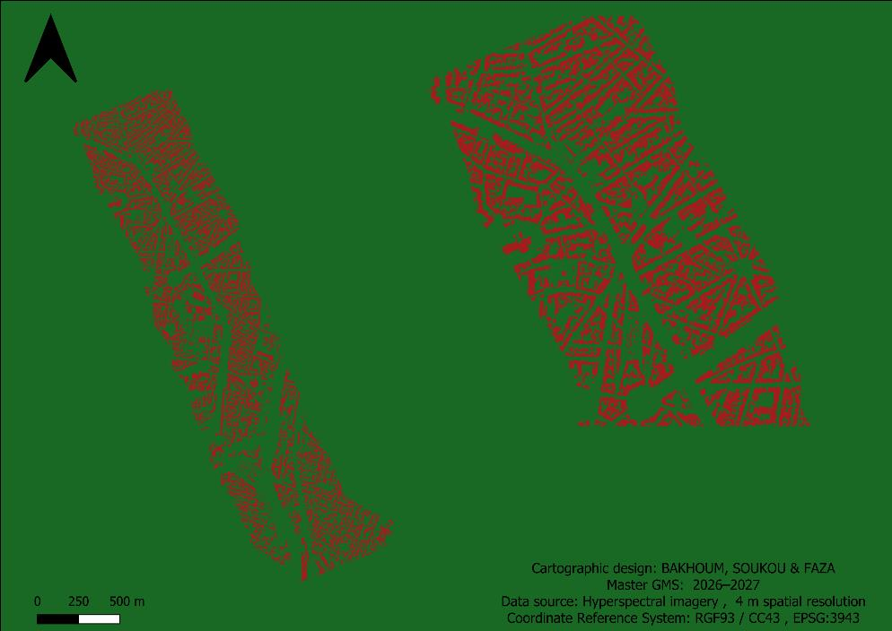

# Types de toitures par imagerie hyperspectrale (Toulouse)

> Identification des matériaux de toiture (béton, tuile, ardoise) à partir d'une image hyperspectrale aéroportée.
> *Detection of roofing materials from airborne hyperspectral imagery: PCA -> MNF -> masking -> K-means.*



**Master 2 Géomatique et modélisation spatiale (GMS)**, Aix-Marseille Université | 2026-2027
Sous la direction de Sébastien Gadal | **Travail de groupe** : A. Bakhoum, F. Omar, A. E. Soukou | Rapport en anglais

---

## Question

Peut-on distinguer automatiquement les matériaux de toiture d'un quartier urbain avec quelques bandes hyperspectrales bien choisies, sans données d'entraînement ?

## Données

- Image **hyperspectrale aéroportée** de Toulouse, résolution **2 m**, RGF93 / CC43 (EPSG:3943)
- **4 bandes retenues** sur l'ensemble du cube :

| Bande(s) | Longueur d'onde | Domaine | Pourquoi |
|---|---|---|---|
| 137 | ≈ 0,9 µm | Proche infrarouge (PIR) | Sépare le bâti de la végétation |
| 295, 298, 301 | ≈ 1,8 µm | Infrarouge à ondes courtes (SWIR) | Sensible à la nature minérale : béton, tuile, ardoise |

## Méthode

```
Image hyperspectrale -> Sélection de bandes -> ACP mode T (comp. 1) -> MNF (comp. 2) -> Masque végétation / eau / voirie -> K-means
```

| Étape | Rôle |
|---|---|
| **Sélection spectrale** | Garder le PIR et le SWIR discriminants et éviter la redondance du cube complet |
| **ACP mode T** | Résumer la variabilité spectrale dominante |
| **MNF** | Séparer le signal utile du bruit, pour des classes plus stables |
| **Masque** | Retirer ce qui n'est pas du bâti avant de classer |
| **K-means** | Classification non supervisée, sans échantillons d'apprentissage |

Le masque est appliqué **avant** la classification. Sinon, le K-means gaspille des classes sur la végétation, l'eau et les routes au lieu de séparer les matériaux.

## Résultats

Une carte des toitures en 5 classes : **ardoise, béton, béton + ardoise (signature mixte), tuile, autre**.

| ACP mode T, composante 1 | MNF, composante 2 | Bâti extrait après masque |
|---|---|---|
|  |  |  |

## Limites

- À 2 m, les petits bâtiments mélangent plusieurs matériaux dans un même pixel.
- Le K-means produit des groupes spectraux : leur nom de matériau reste à **valider sur le terrain** ou sur orthophoto.
- La classe mixte béton + ardoise traduit une confusion spectrale partielle.

## Outils

`ENVI` | ACP | MNF | K-means

## Contenu du dépôt

- `figures/` : composantes ACP/MNF, extraction du bâti, carte finale
- `rapport/` : rapport complet (PDF, anglais)

---

**Auteur :** Ezechiel Agbewanou SOUKOU, géomaticien-urbaniste | [LinkedIn](https://www.linkedin.com/in/ezechiel-soukou) | [Autres projets](https://github.com/ezekielofficiel7-spec)
